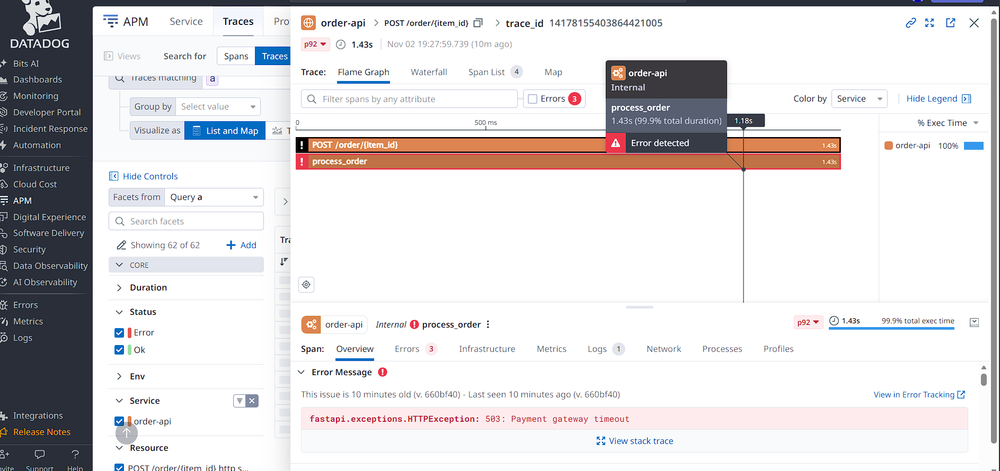
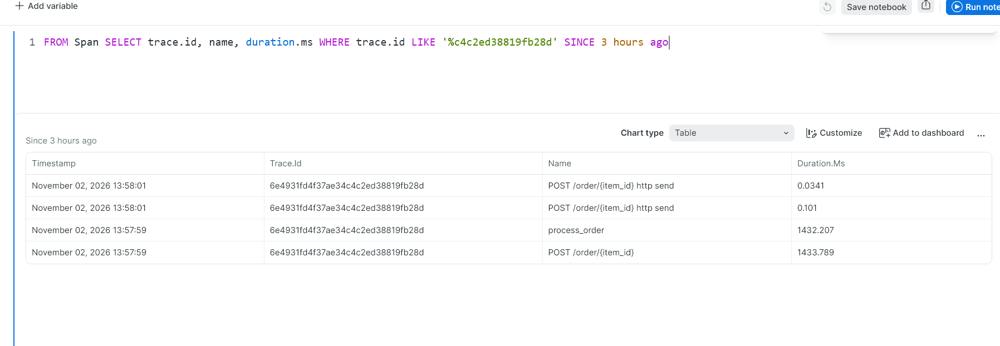
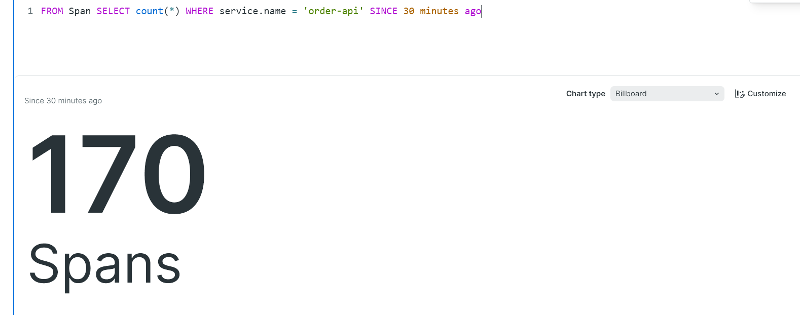
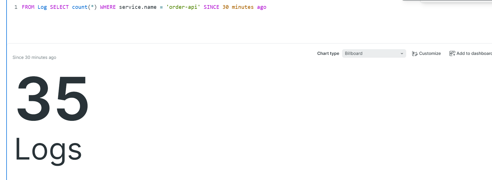
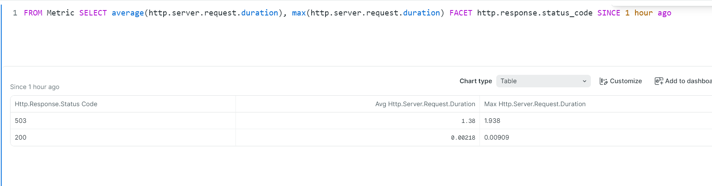
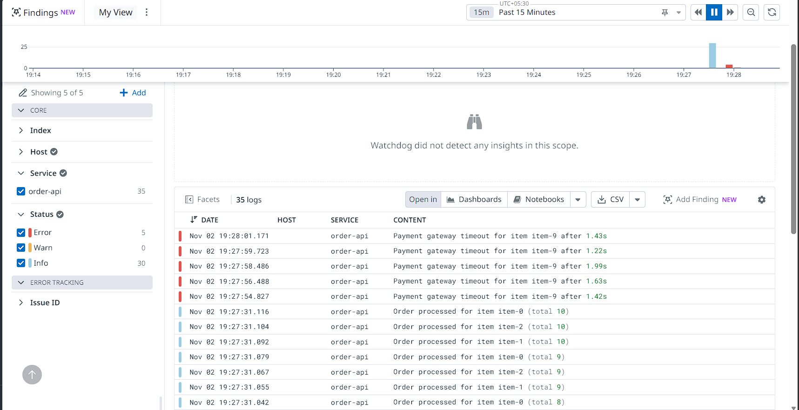
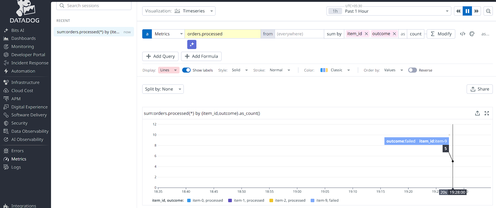

# Chapter 3: two vendors, one pipeline, 2026-11-02

## One request, one trace ID, seen in both vendors

A failed order (simulated payment-gateway timeout) at 13:57:59 UTC has the OpenTelemetry trace ID `6e4931fd4f37ae34c4c2ed38819fb28d`. Datadog displays its last 16 hex digits as a decimal number: `c4c2ed38819fb28d` = `14178155403864421005`.

| Datadog APM | New Relic |
|---|---|
|  |  |

- **Datadog:** `POST /order/{item_id}` → `process_order`, 1.43 s, 503. Error Tracking grouped `HTTPException: 503: Payment gateway timeout` and tagged it with version `660bf40`. The trace links to its own error log through the trace ID that every OpenTelemetry log record carries.
- **New Relic:** the same 4 spans: the request (1433.789 ms), `process_order` (1432.207 ms) and two response-send spans.

## One exporter type for both vendors

Both use OTLP over HTTP. Only the address and the key header differ:

```text
otlp_http/newrelic -> https://otlp.nr-data.net         header: api-key
otlp_http/datadog  -> https://otlp.us5.datadoghq.com   header: dd-api-key
```

- Keys live in a git-ignored `.env` that only the Collector container receives (`env_file`); the API never sees them.
- Each exporter has its own sending queue and retries.
- `deployment.environment` was renamed to its current semantic-convention name, `deployment.environment.name`.

## The same run reaches both vendors

30 orders + 5 simulated payment-gateway timeouts. Collector self-metrics after the run:

```text
otelcol_exporter_sent_spans{exporter="otlp_http/datadog",server_address="otlp.us5.datadoghq.com",url_path="/v1/traces"} 170
otelcol_exporter_sent_spans{exporter="otlp_http/newrelic",server_address="otlp.nr-data.net",url_path="/v1/traces"} 170
otelcol_exporter_sent_log_records{exporter="otlp_http/datadog",server_address="otlp.us5.datadoghq.com",url_path="/v1/logs"} 35
otelcol_exporter_sent_log_records{exporter="otlp_http/newrelic",server_address="otlp.nr-data.net",url_path="/v1/logs"} 35
otelcol_exporter_sent_metric_points{exporter="otlp_http/datadog",server_address="otlp.us5.datadoghq.com",url_path="/v1/metrics"} 47
otelcol_exporter_sent_metric_points{exporter="otlp_http/newrelic",server_address="otlp.nr-data.net",url_path="/v1/metrics"} 29
```

- No `send_failed` series: neither vendor rejected anything.
- 170 spans = 30 orders × 5 (request, 2 response-send spans, `process_order`, Redis `INCRBY`) + 5 faults × 4 (no Redis call).
- Datadog's 18 extra metric points are rate, error and duration metrics computed from the spans by the `span_metrics` connector, for Datadog's APM pages only. New Relic builds its own from the spans.

## New Relic (US), queried after an identical run

| Spans | Logs |
|---|---|
|  |  |



- Request duration by status code: 503 averaged 1.38 s (max 1.938 s; the simulated timeout is 0.8 to 2 s), 200 averaged 2.18 ms (max 9.09 ms).
- `NrIntegrationError` had no events: nothing was dropped after intake.
- Metrics in New Relic are pre-aggregated: `count(*)` on `Metric` returned 0, so they are queried with `sum()` and `average()`.

## Datadog (us5)





- Logs, `service:order-api`: 35 (30 info, 5 error).
- `sum:orders.processed{*} by {item_id,outcome}.as_count()`: item-0 processed 10, item-9 failed 5.

## Lesson from the run

After the config changed, the Collector kept sending to New Relic only. Its counters had doubled (340 spans = 2 × 170) instead of starting from 0: it was still the old process. The Collector reads its config only at startup, so a config change needs `docker compose up -d --force-recreate`.
