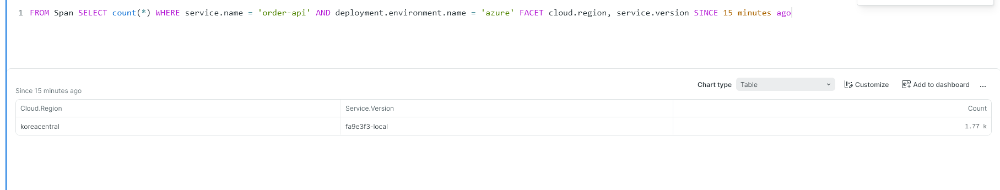
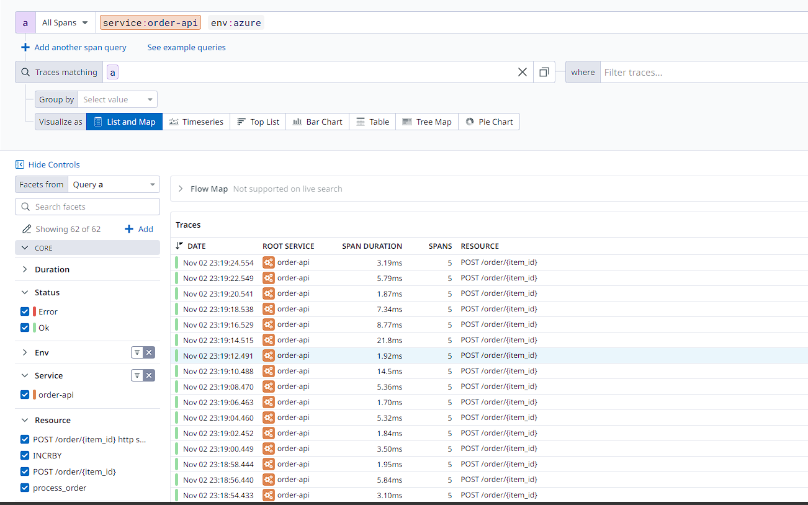
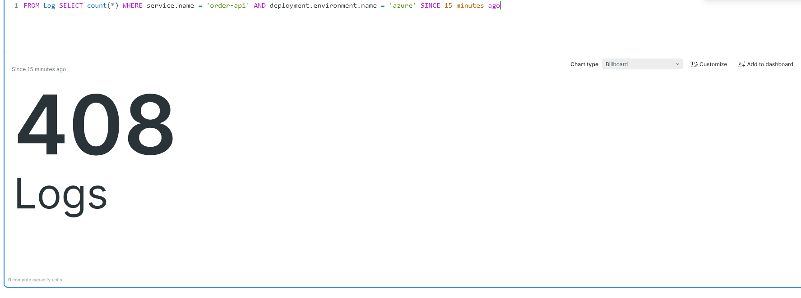
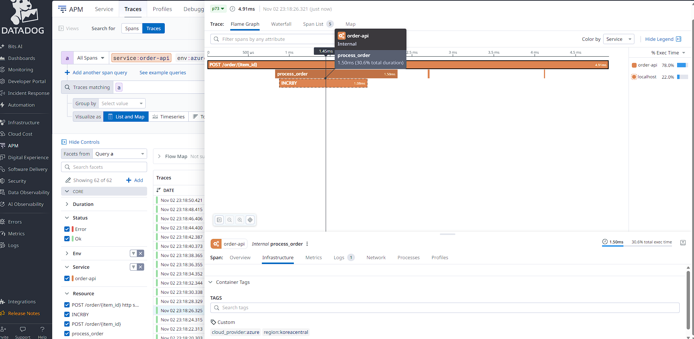

# Chapter 4: Azure with Terraform, 2026-11-03

The same containers as `compose.yaml`, plus a load generator, run in one Azure Container Instances group in Korea Central. Terraform builds everything from two folders: `infra/bootstrap` (budget and state storage, with local state) and `infra/main` (registry, identity and container group, with remote state).

## Data from Azure reaches both vendors

| New Relic: spans from `koreacentral`, version `fa9e3f3-local` | Datadog: `env:azure`, one trace every 2 seconds |
|---|---|
|  |  |

| New Relic: 408 logs in 15 minutes (30 orders a minute) | Datadog: request, `process_order`, Redis `INCRBY`, tagged `cloud_provider:azure` and `region:koreacentral` |
|---|---|
|  |  |

## Safety first: budget and state

```text
$ terraform plan (infra/bootstrap)               -> Plan: 6 to add, 0 to change, 0 to destroy.
$ az consumption budget list                     -> budget-aci-observability  1000.0  Monthly
$ az storage account list (state storage)        -> sharedKey False  publicBlob False  TLS1_2  Standard_GRS
$ git check-ignore backend.hcl terraform.tfstate -> both ignored
$ ls infra/main/terraform.tfstate                -> no local state file
$ az storage blob list --auth-mode login         -> main.tfstate
```

- The ₹1,000 monthly budget alerts at 50%, 80% and 100% of actual spend and at 100% of forecast. It emails the subscription's Owner role, so no address is in the code.
- The state storage accepts only Entra ID sign-ins (shared keys are disabled), allows no anonymous access, keeps every version and is geo-replicated. Terraform locks the state blob during each plan and apply.

## No passwords, no public IP

```text
$ az acr show                                    -> Basic  adminUser False
$ az role assignment list (registry scope)       -> AcrPull  (the container group's managed identity only)
$ az container show                              -> Running, no public IP
order-api       0 restarts  order-api:fa9e3f3-local
redis           0 restarts  redis@sha256:21090af93f8324db2f0f0f4f38a7c60369d47d917e000c3423d89d2ae2883537
otel-collector  0 restarts  otel/opentelemetry-collector-contrib@sha256:340c9ca6a36617084c6661bdc4f0fe92b7cda5a805d61673ec8db375fddc522b
loadgen         0 restarts  order-api:fa9e3f3-local
$ az container logs --container-name loadgen     -> loadgen: last 30 requests by status: {200: 30}
```

- Trivy scanned the API image before the push: 0 fixable HIGH or CRITICAL findings across the Wolfi base and all 37 Python packages.
- Redis and the Collector were imported into the registry by the same digests as `compose.yaml`, and the container group pulls them by digest.
- The load generator is the API image with a different start command (`python -m src.loadgen`), so the group runs no extra third-party image.
- The New Relic and Datadog keys are secure environment variables, hidden in the portal and the Azure API.

## Checkov for Terraform

```text
Passed checks: 16, Failed checks: 0, Skipped checks: 15
```

One finding was fixed: the state storage now uses geo-redundant replication. Each of the 15 skips is a `checkov:skip` comment inside its resource, with the reason:
- 6 registry controls need the Premium tier, at about 10x the price. Content trust is retired in ACR. Registry scanning is a paid Defender plan, so Trivy scans the image instead.
- The state storage is reached from Codespaces and GitHub runners, which have no fixed IPs.
- The container group has no IP address at all, so a virtual network would only add outbound plumbing.

## What ACI taught me

1. **The HTTP liveness probe counted healthy responses as failures.** Azure restarted the API every ~100 s with `Liveness probe failed: ... HttpStatusCode:200`, while the API's own log showed the probe's `GET /health` returning `200 OK`. Fix: an `exec` probe that runs the Dockerfile's `HEALTHCHECK` command inside the container.
2. **ACI splits `exec` probe arguments at commas.** The next version failed with `SyntaxError: '(' was never closed`, cut exactly at the comma before `timeout=2`. The Terraform provider passes the list unchanged (I checked its source), so the split happens in Azure. Fix: a command with no commas, with the probe's `timeout_seconds` limiting the check instead.
3. **The provider rejects empty strings in `commands`.** So Redis's `--save ""` runs through `sh -c`, still via the image's entrypoint, which drops from root to the `redis` user.

One startup warning remains: the first liveness check, 31 s after start, fails once because the API needs a little over 30 s to start on 0.5 vCPU. It never causes a restart, which takes 3 failures in a row. The delay goes up in Chapter 5, when the group is next recreated.
