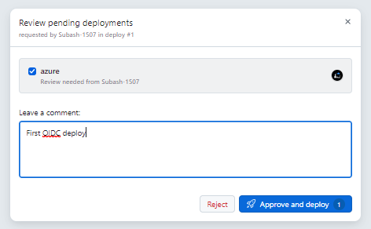
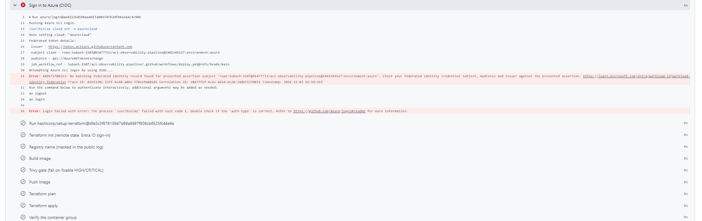
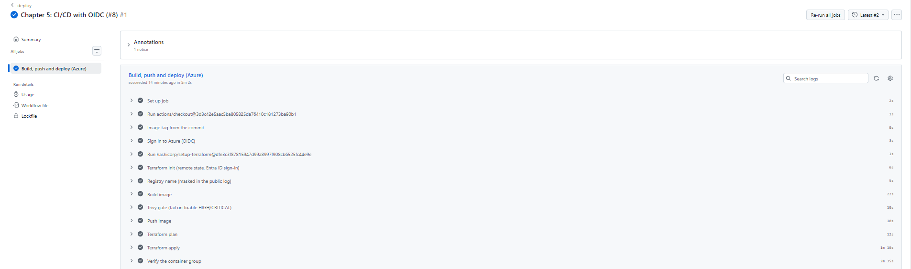
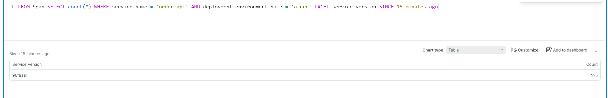

# Chapter 5: CI/CD with OIDC, 2026-11-03

GitHub Actions now builds, scans, pushes and deploys the API to Azure Container Instances. It signs in to Azure with OpenID Connect (OIDC): GitHub issues a short-lived token for each run, and Azure trusts only an exact statement about this repository and GitHub environment. No Azure password or key is stored anywhere.

## Who may do what

| Identity | Trusted for | Can do | Approval |
|---|---|---|---|
| `id-aciobs-deploy` | GitHub environment `azure` | Contributor on the app resource group; read and write the Terraform state container | Every run waits for a reviewer |
| `id-aciobs-power` | GitHub environment `azure-power` | A custom role: read, start and stop container groups, nothing else | None (the Start and Stop buttons) |

- Both identities and their roles are defined in `infra/ci`, which a person runs, never the pipeline, so the pipeline cannot widen its own permissions. Both live in the state resource group, where neither has any rights.
- The `azure` environment requires a reviewer, has administrator bypass turned off and accepts deployments from `main` only. `azure-power` accepts `main` only.
- The Azure IDs, the state storage account name and the vendor keys are environment secrets, masked in the public logs.

## The approval gate



The deploy started on merge and waited for review before touching Azure:

```text
deploy | status=waiting | pending environment: azure | reviewers: Subash-1507
```

## First attempt: rejected by Azure, as it should be



```text
AADSTS700213: No matching federated identity record found for presented assertion subject
'repo:Subash-1507@91477713/aci-observability-pipeline@1441545527:environment:azure'
```

This repository sends GitHub's immutable OIDC subject: the owner and repository names plus their numeric IDs. The trust expected the older name-only form, so Azure refused the token and nothing was deployed. Both trusts now use the exact prefix GitHub sends (`gh api repos/Subash-1507/aci-observability-pipeline/actions/oidc/customization/sub`). As a bonus, a renamed repository, or a new one re-created under the same name, cannot sign in.

## Second attempt: deployed end to end



```text
subject claim - repo:Subash-1507@91477713/aci-observability-pipeline@1441545527:environment:azure
Azure CLI login succeeds by using OIDC.
Successfully configured the backend "azurerm"!
96f8aa1: digest: sha256:0113f083d3c786b56882762dc3b1ff038b3746aa46b98651f46924a08050c877 size: 856
  # azurerm_container_group.app must be replaced
Plan: 1 to add, 0 to change, 1 to destroy.
Apply complete! Resources: 1 added, 0 changed, 1 destroyed.
order-api       Running  0
redis           Running  0
otel-collector  Running  0
loadgen         Running  0
loadgen: last 30 requests by status: {200: 30}
```

- The image is tagged with the commit (`96f8aa1`, the merge of PR #8) and must pass the Trivy gate before it is pushed.
- The verify step fails the run unless all 4 containers are running. With the API's liveness delay raised to 60 s (the Chapter 4 follow-up), all four ran with 0 restarts.

## Every signal points to the commit that produced it



In the 15 minutes after the deploy, every span from Azure carried `service.version = 96f8aa1`. An alert leads to a trace, and the trace leads to the exact commit and pull request.

## The Stop button

```text
aci-stop | Sign in to Azure (OIDC, start/stop only): success
subject claim - repo:Subash-1507@91477713/aci-observability-pipeline@1441545527:environment:azure-power
Stopped
```

## Nothing private in the public logs

```text
deploy log:   1096 lines; raw subscription, tenant or client IDs, storage or registry names: 0; values masked as ***: 164
aci-stop log: raw IDs or names: 0
```
