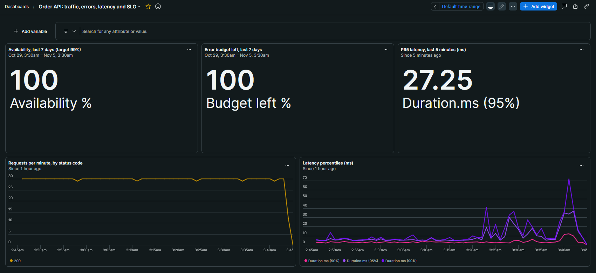
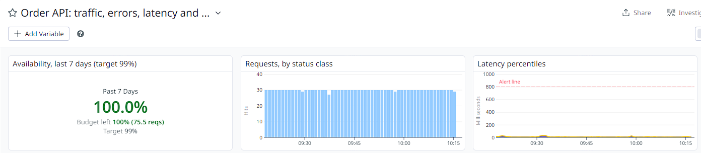
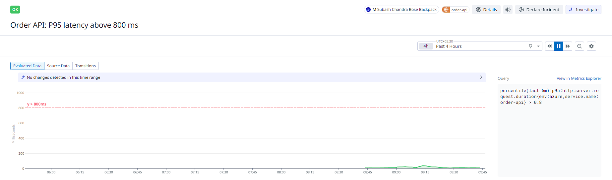
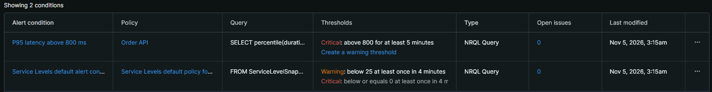

# Chapter 6: Dashboards, SLO and alerts, 2026-11-05

The reliability settings are code in `infra/observability`: an SLO, an alert and a dashboard in each of New Relic and Datadog, with the email path behind each alert. Anyone can read them in the repo, rebuild them with `terraform apply` and remove them with `terraform destroy`.

## What healthy looks like

Before choosing any limit, I measured normal traffic in Azure with no faults:

```text
New Relic spans:   399 requests in 15 minutes, all 200. P50 2.695 ms, P95 5.391 ms, P99 6.328 ms
New Relic metric:  P95 6.42 ms (estimated from histogram buckets)
Datadog metric:    P95 5.07 ms
```

## What I set, and why

| | New Relic | Datadog |
|---|---|---|
| **SLO: 99% availability over 7 days** | Good = server span with a status under 500 | Good = `trace.http.server.request.hits.by_http_status` without `5xx` |
| **Alert: P95 above 800 ms for 5 minutes** | Reads spans | Reads the `http.server.request.duration` histogram |
| **Notification** | Email through a workflow | Email in the monitor message |

- **Why 800 ms:** normal P95 is about 150 times lower. The simulated payment timeout takes 0.8 to 2 s, so P95 only crosses the line once more than 5% of orders hit it.
- **Why New Relic reads spans:** they are exact and arrive within seconds. The metric is an estimate and is sent once a minute.
- **Why Datadog's SLO uses a different metric:** an SLO needs a count metric, and this one carries the status class. In Datadog, the `span_metrics` output appears as `trace.http.server.request.*`.
- **A stopped group is not an incident:** the group is stopped when idle, so neither alert fires on missing data.
- **Admin keys stay out of the pipeline:** I run this folder myself. Its keys live in their own git-ignored file, because Docker Compose passes the root `.env` to the Collector. The Datadog application key is limited to nine scopes.

## The result

```text
Apply complete! Resources: 10 added, 0 changed, 0 destroyed.
Availability 100% and error budget 100% in both vendors
Datadog error budget: 75.5 requests (1% of about 7,550 in 7 days)
Alerts: New Relic 0 open issues, Datadog monitor OK
Test notifications: email arrived from both vendors
```









P95 later rose from about 5 ms to a peak near 40 ms with no change to the app. That is still 20 times below the limit, and I have not found the cause.

## Two problems caught along the way

- **Empty SLO tiles:** two New Relic tiles showed "No value" because I filtered on `sli.guid`. New Relic's provider source uses `entity.guid`, and the tiles then showed 100%.
- **An unexpected change in a plan:** a one-line dashboard fix also wanted to change the email destination. New Relic had added its own `link_sent_email` property, and new addresses must be verified before they receive notifications. The property is not documented, so I stopped, and Terraform now ignores changes to that destination's properties. Only the dashboard changed.

New Relic also created its own default alert policy for service levels. Terraform does not manage that policy, so it is on the Chapter 8 cleanup list.

## Not proven yet

No alert has fired. The test emails prove the notification path, not the thresholds. Chapter 7 injects real faults and measures how fast both alerts detect them.
