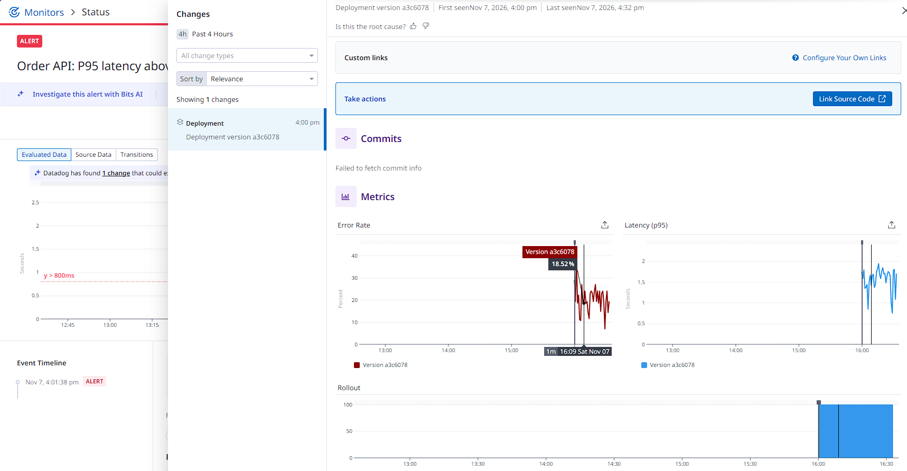
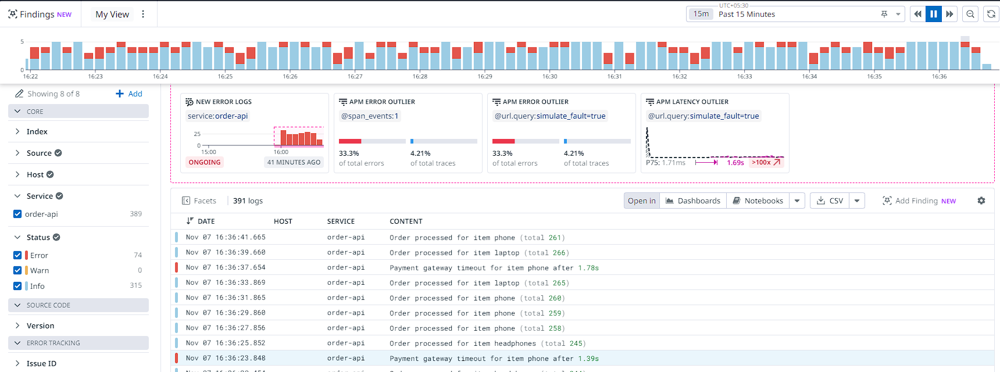
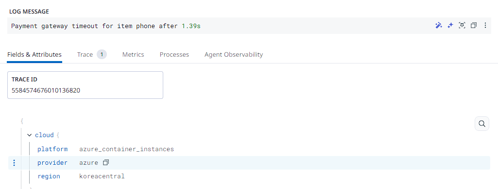
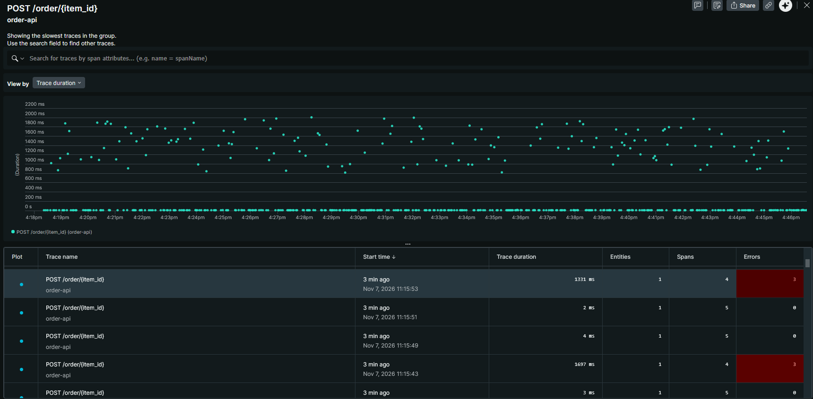
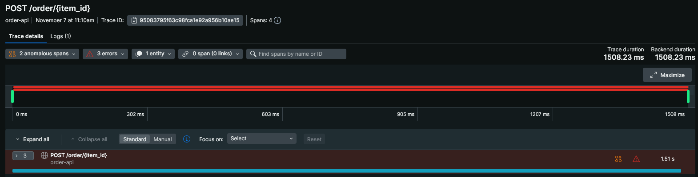
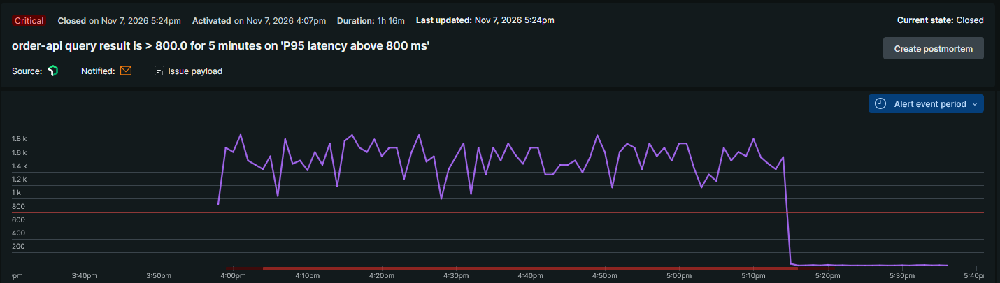
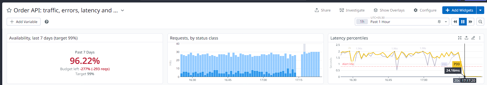
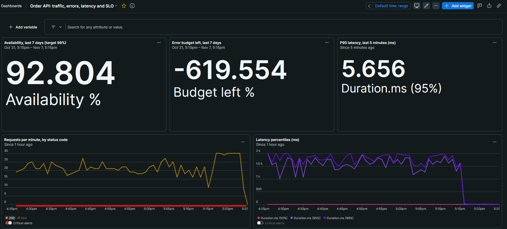

# Chapter 7: Incident drill, 2026-11-07

I shipped a bad release on purpose and handled it like a real incident: I watched both alerts fire, followed them to the cause, rolled back through the normal pipeline and timed each step.

- **The bad release:** [PR #15](https://github.com/Subash-1507/aci-observability-pipeline/pull/15) changed `loadgen_fault_percent` from 0 to 20. One order in five then asks the API for its simulated payment-gateway timeout, which waits 0.8 to 2 s and returns 503. The change went through the same checks, approval and deploy as any release.
- **The fix:** GitHub's Revert button on that PR, which opened [PR #16](https://github.com/Subash-1507/aci-observability-pipeline/pull/16).

All times are IST (UTC+5:30) on 7 November 2026. New Relic's trace lists show UTC.

## Timeline

| IST | What happened |
|---|---|
| 15:50:53 | PR #15 merged. The deploy waited for my approval |
| 15:57:55 | I approved the deploy |
| **15:59:57** | **First failed order** (NRQL) |
| 16:00:07 | Terraform apply finished |
| **16:01:38** | **Datadog alert** |
| 16:02:46 | Deploy check green: the last 30 orders were `{200: 23, 503: 7}` |
| **16:07** | **New Relic alert** |
| 16:35 | New Relic's built-in error-budget alerts opened |
| About 16:37 | Followed the alerts to the deployment, a slow trace and its log line |
| 17:03:00 | Opened the revert, PR #16 |
| 17:04:32 | Revert merged. The rollback deploy waited for my approval |
| 17:14:23 | I approved the rollback |
| **17:15:29** | **Last failed order** (NRQL), during the Terraform apply |
| 17:16:48 | Terraform apply finished |
| 17:19:21 | Rollback check green: `{200: 30}`, 4 containers running, 0 restarts |
| **17:19:38** | **Datadog alert recovered** |
| **17:24** | **New Relic issue closed** |

## The numbers

| | Datadog | New Relic |
|---|---|---|
| **Time to detect** (first failed order to alert) | 1 min 41 s | about 7 min |
| **Time to show recovery** (last failed order to alert closed) | 4 min 9 s | about 8.5 min |

- **Impact:** the faults ran for 75 min 32 s and 402 orders failed, all with 503. I left them running for about an hour on purpose, to investigate in both tools. In a real incident I would roll back first and investigate after.
- **Rollback:** 12 min 29 s from opening the revert to the last failed order. **9 min 51 s of that was the deploy waiting for my approval.** Once approved, the faults stopped within 66 seconds.

## Why Datadog was faster

- **Datadog** checks the P95 of the last 5 minutes, and with `require_full_window = false` it does not wait for a full window. With one order in five taking 0.8 to 2 s, P95 jumped to 1.88 s within a minute.
- **New Relic** waits until every 1-minute window has been above 800 ms for 5 minutes, then adds 60 s for late data. That costs about 7 minutes each way, but one slow minute can never trigger it.

Neither is wrong: Datadog's rule is quicker, and New Relic's is harder to trip by accident.

## From alert to cause

**Datadog**

1. The alert page named a likely cause: deployment version `a3c6078`, the drill's commit, first seen at 16:00. That version's error rate was 18.52% at 16:09.
2. Findings flagged orders with `simulate_fault=true` as error and latency outliers, more than 100 times slower than the usual P75 of 1.71 ms.
3. Their log lines say `Payment gateway timeout for item phone after 1.39s`, and each one carries its trace ID.

**New Relic**

1. Slow traces form a second band at 0.8 to 2 s, apart from normal orders at a few milliseconds.
2. A failed trace: 1.51 s, 3 errors and 1 linked log line.
3. The errors inbox shows one group: `POST /order/{item_id}`, 503 Service Unavailable.

## Recovery

The gap in Datadog's request bars at about 17:15 is the container group being replaced.

## Two SLOs, two answers

| | Availability | Error budget left |
|---|---|---|
| Datadog SLO | 96.22% | -277% (293 requests over) |
| New Relic service level | 92.804% | -619.554% |
| New Relic spans, counted directly with NRQL | 96.44% | |

Both tools saw the same 402 failed orders, but they divide by different totals:

- Datadog works out its SLO from the metric's history, so it counts every request in the last 7 days.
- New Relic's service level started counting when I created it on 5 November, so it counts about 5,600 requests, half as many.
- Counting the raw spans for 7 days gives 11,300 requests and 96.44%, close to Datadog. I ran that query after stopping the app, so it includes about 30 more minutes of good traffic.

Before comparing two SLOs, check when each one started counting.

## Lessons

1. **The approval gate slowed the rollback most.** It is there to stop bad changes, but reverting the last release is low-risk. Next step: a pre-approved rollback path, such as a workflow that can only redeploy the previous image.
2. **A rollback still drops traffic for about a minute.** Container Instances replaces the whole group on every change. A real service needs two copies behind a load balancer, or a platform with rolling updates.
3. **Alert text must match the rule.** Datadog's message says "above 800 ms for 5 minutes", but the rule fired after 1 min 41 s, and the Recovered email repeated the same sentence. Next step: describe the rule as it is, and use `{{#is_recovery}}` for a separate recovery message.
4. **A small SLO window burns fast.** The app only runs during my sessions, so 7 days held about 11,000 orders, and one hour of 20% faults spent the budget several times over.
5. **An alert I did not write fired.** New Relic's default service-level policy opened two error-budget alerts at 16:35. They stay open until the failed orders leave the 7-day window, around 14 November. Terraform does not manage that policy, so Chapter 8 removes it.
6. **I started a second deploy by mistake.** While the first one waited for approval, I ran the deploy workflow by hand. The concurrency group queued it behind the first, and I cancelled it. Check the queue before running a workflow by hand.

## Not proven

- This was a planned drill: I knew the cause before the alert fired. A real incident would take longer to diagnose.
- The fault is simulated inside the API, not a real payment gateway.
- I am the only approver, so a rollback can only be as fast as my reply.
